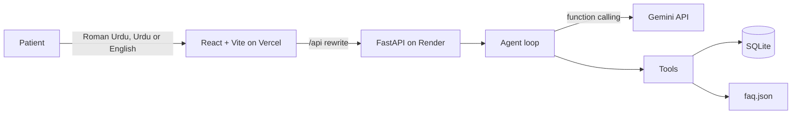

<div align="center">

# Mulaqat

### Urdu-first AI receptionist that books appointments with a tool-calling agent

Patients write in Roman Urdu, Urdu or English. The agent checks the diary, books the slot and shows every step it takes.

<p>
  <a href="https://mulaqat-ai-booking-agent.vercel.app/"></a>
  <a href="https://mulaqat-api.onrender.com/api/health"></a>
  <a href="https://asmashahzadi764-alt.github.io/Personal-Portfolio/"></a>
  <a href="https://github.com/asmashahzadi764-alt/mulaqat-ai-booking-agent"></a>
</p>

<p>
  <a href="https://github.com/asmashahzadi764-alt/mulaqat-ai-booking-agent/actions/workflows/ci.yml"></a>
  
  
</p>

</div>

> **Unofficial demo.** Built for Multan Dental Clinic using only publicly listed information (address and timings). It is not affiliated with or endorsed by the clinic. Fees, policies and bookings are not real.

<!--
Add your screenshots to a docs/ folder, then remove this comment markers:


-->

## Table of contents

- [Overview](#overview)
- [Features](#features)
- [How it works](#how-it-works)
- [Tech stack](#tech-stack)
- [Getting started](#getting-started)
- [Environment variables](#environment-variables)
- [API](#api)
- [Tests and CI](#tests-and-ci)
- [Deployment](#deployment)
- [Project structure](#project-structure)
- [Roadmap](#roadmap)
- [Author](#author)

## Overview

Most booking tools speak English, while patients message in Roman Urdu and Urdu. Mulaqat is a receptionist that answers in the patient's own language and script.

It is a real **tool-calling agent**, not a scripted chatbot. The model decides when to look at the diary, book, cancel or search clinic information, and the backend runs real code for each step. Every decision is written to an **agent ledger** beside the chat, so nothing happens in the dark.

## Features

| | |
| --- | --- |
| **Tool-calling agent** | Four tools: `check_slots`, `book_appointment`, `cancel_appointment`, `search_faq`. |
| **Urdu-first** | Replies in the patient's own language and script. |
| **Agent ledger** | Each tool call is shown in plain words, with the raw data one click away. |
| **Safe booking** | A partial unique index in SQLite rejects double booking, even when two chats race for one slot. |
| **Grounded answers** | Address, hours and doctor come from `faq.json`. Fees are not published, so the agent never quotes prices. |
| **Tappable slots** | Free times appear as buttons under the agent's reply. |
| **Owner dashboard** | JWT login unlocks full phone numbers and cancellation. Public visitors see masked numbers. |
| **Abuse protection** | In-memory rate limits on chat (20 per 10 minutes per IP) and login (5 per 5 minutes). |
| **Resilient AI calls** | Overloaded or retired models are retried, then replaced by fallback models. |
| **Demo mode** | With no AI key the app still answers slot and FAQ questions locally. |

## How it works



1. The UI sends the conversation to `POST /api/chat`.
2. The agent loop calls the model with four tools. When the model asks for a tool, the backend runs it, returns the result and repeats (up to 6 steps).
3. The reply and the full tool trace go back to the UI, which renders the chat, the slot buttons and the ledger.

## Tech stack

**Frontend**


**Backend**


**AI**


-D97757?style=for-the-badge&logo=anthropic&logoColor=white)

**Testing and CI**


**Deployment**


## Getting started

Requirements: Python 3.10+ and Node.js 20+.

```bash
git clone https://github.com/asmashahzadi764-alt/mulaqat-ai-booking-agent.git
cd mulaqat-ai-booking-agent
```

**Backend** (terminal 1)

```bash
cd backend
python -m venv .venv
source .venv/bin/activate          # Windows: .venv\Scripts\Activate.ps1
pip install -r requirements.txt
cp .env.example .env               # then fill in your keys
uvicorn main:app --reload          # http://127.0.0.1:8000
```

**Frontend** (terminal 2)

```bash
cd frontend
npm install
npm run dev                        # http://localhost:5173
```

Open `http://127.0.0.1:8000/api/health`. You should see `"mode":"live"` once a key is set, or `"mode":"demo"` without one. A free Gemini key is available from Google AI Studio. Never commit `.env`; it is already in `.gitignore`.

## Environment variables

| Variable | Required | Purpose |
| --- | --- | --- |
| `GEMINI_API_KEY` | For live AI | Gemini API key. Without any AI key the app runs in demo mode. |
| `GEMINI_MODEL` | No | Main model. Defaults to `gemini-flash-latest`. |
| `GEMINI_FALLBACKS` | No | Comma-separated backup models used when the main one is overloaded or retired. |
| `ANTHROPIC_API_KEY` | No | Use Claude instead of Gemini (only if no Gemini key is set). |
| `ADMIN_PASSWORD` | For owner login | Password for the owner dashboard. Login is disabled when empty. |
| `JWT_SECRET` | Recommended | Signs login tokens. Any long random string. |

## API

| Method | Route | Auth | Purpose |
| --- | --- | --- | --- |
| `POST` | `/api/chat` | none, rate limited | Send the conversation, get `reply` and `trace` |
| `POST` | `/api/admin/login` | password, rate limited | Returns a JWT valid for 8 hours |
| `GET` | `/api/appointments` | optional token | Upcoming bookings, phone masked without a token |
| `DELETE` | `/api/appointments/{id}` | owner token | Cancel a booking |
| `GET` | `/api/health` | none | Provider, mode and whether owner login is set up |

## Tests and CI

```bash
cd backend
pytest
```

13 tests cover slot rules, double-booking prevention, cancellation, Sunday closure, phone validation, FAQ grounding, owner login, phone masking, protected cancellation and rate limiting.

GitHub Actions runs the backend tests and the frontend build on every push and pull request.

## Deployment

| Part | Platform | Notes |
| --- | --- | --- |
| Frontend | Vercel | Root directory `frontend`. `frontend/vercel.json` rewrites `/api/*` to the backend. |
| Backend | Render | Blueprint in `render.yaml`, free plan, Python 3.11.8. |

Known limits of the free plans:

- The Render service sleeps after about 15 minutes without traffic, so the first request can take 30 to 50 seconds.
- Render's free disk is ephemeral, so SQLite bookings reset on redeploy. That is fine for a demo.
- Gemini's free tier has its own rate limits, which is why chat is rate limited per IP.

## Project structure

```
.
├── .github/workflows/ci.yml      # tests and build on every push
├── render.yaml                   # Render blueprint (backend)
├── backend/
│   ├── main.py                   # FastAPI routes
│   ├── agent.py                  # Gemini / Claude tool-calling loop, demo mode
│   ├── tools.py                  # check_slots, book, cancel, search_faq
│   ├── db.py                     # SQLite schema and slot rules
│   ├── security.py               # JWT owner login, rate limiter
│   ├── faq.json                  # clinic knowledge base
│   ├── test_tools.py  test_api.py
│   └── check_gemini.py           # helper to find a working Gemini model
└── frontend/
    ├── vercel.json               # /api rewrite to Render
    └── src/
        ├── App.jsx               # landing page
        ├── Console.jsx           # chat, diary and agent ledger
        ├── useReveal.js          # scroll animations
        └── index.css
```

## Roadmap

- [ ] Postgres for persistent bookings
- [ ] Embedding-based retrieval for larger knowledge bases
- [ ] WhatsApp Business API channel using the same agent
- [ ] Per-doctor schedules and appointment reminders

## Author

<a href="https://asmashahzadi764-alt.github.io/Personal-Portfolio/"></a>
<a href="https://github.com/asmashahzadi764-alt"></a>

If this project helped or interested you, a star on the repository is appreciated.